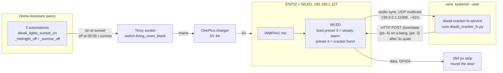

# Diwali lights (door outline)

A WS2812B outline around the front door, driven by its own ESP32 running WLED -
the second WLED board in the house after the aarti lights, and set up the same
way. Built 2026-10-30.

- [`wiring.html`](wiring.html) - the wiring and pixel layout as built.
- [`diwali_wled.sh`](diwali_wled.sh) - the whole setup path in one script:
  hand the board the house WiFi over USB serial (or its own AP), move it to a
  static IP, set count/pin/order/current cap/name, **load-test the supply**,
  then save the warm diya effect as boot preset 1.

Flash the board first with
[`tools/esp32-tools/flash-wled-audioreactive.sh --flash`](../../tools/esp32-tools/README.md).

The load test is not optional: the supply is a OnePlus fast charger labelled
5V 4A, and proprietary fast chargers may only deliver full current after a
handshake the ESP32 cannot do - so the usable ceiling has to be measured, not
read off the label.

## How it works



**An evening, step by step:**

1. **Sunset:** HA turns the Tinxy socket on (and the akash kandil relay, `projects/smart-switch/`). That is the only "on" switch - HA has no WLED integration for this board.
2. **Board powers up** and WLED loads its **boot preset (3, steady warm)**. No network needed; this is also what happens after a power cut.
3. **Mic -> board -> xero:** WLED's AudioReactive usermod sends its FFT results as UDP multicast. The board does not react to sound itself.
4. **xero decides:** `diwali_cracker_fx.py` watches the high bands; on a bang it tells WLED "preset 4", 3s after the last bang "preset 3".
5. **00:00 (or sunrise on the all-night evenings):** HA cuts the socket. The board loses power and forgets everything not saved.

**The parts and what each one is for:**

| Part | Where | Needed at runtime? | If it is missing |
|---|---|---|---|
| WLED + presets 3/4 + boot preset | on the board (`presets.json`, `cfg.json`) | yes | strip lights with whatever the board boots into |
| 3 HA automations + Tinxy socket | `HOMEASSISTANT_CONFIG/automations.yaml` (gitignored) | yes - the on/off | lights never come on, or never go off |
| `diwali_cracker_fx.py` via `diwali-cracker-fx.service` | xero | only for bursts | steady warm all evening, no bursts |
| `diwali_audio_levels.py` | run by hand on xero | no - tuning tool | nothing; it only prints levels to pick the threshold |
| `diwali_wled.sh` | run by hand | no - one-time setup | nothing |

**What survives the nightly power cut** (from WLED's behaviour, not a test):

| Change made in the WLED UI | Tomorrow evening |
|---|---|
| Picked an effect / colour / brightness, did not save | **gone** - boots into preset 3 |
| Picked another preset (2, 4, ...) | **gone** - boots into preset 3 |
| Pressed **Save** on preset 3 (overwrote it) | **kept** - that *is* the new steady look |
| Changed boot preset (Config -> LED Preferences) or any Config page | **kept** |

**Traps:**

- **Turning it on from the WLED app/UI while the socket is off does nothing** - the board has no power. Use the Tinxy switch.
- **The listener only switches while preset 3 or 4 is showing.** Pick anything else in the UI and bursts stop until you pick 3 again (or the next evening's boot).
- **No copy of `presets.json` / `cfg.json` in the repo.** Overwrite preset 3 by accident and the original values are only in the table below.

## Firecracker mode (set up 2026-11-05)

Steady warm light normally; a firework burst animation on a cracker, for ~3s
after the last bang. WLED's own sound-reactive effects could not do this: the
mic reads a loud constant floor in the low/mid bands (not caused by the strip -
dimming it changes nothing), so they stay busy all the time. A cracker shows as
a spike in the high FFT bins, so a listener on xero watches those instead.

| Preset | What |
|---|---|
| 2 | Funky: Colorwaves, Party palette (the old boot preset) |
| 3 | **Steady warm** - solid `255,120,10`, bri 128. **Boot preset** (`def.ps`) |
| 4 | Cracker burst - Fireworks Starburst, Party palette, bri 200 |

Board AudioReactive settings: AGC off, squelch 0, gain 10, sync **send** on
port 11988 (multicast 239.0.0.1).

- [`diwali_cracker_fx.py`](diwali_cracker_fx.py) - the listener: high-band mean
  >= 220 for 4 packets in a row -> preset 4; 3s quiet -> preset 3. Leaves the
  board alone if another preset is showing.
- [`diwali-cracker-fx.service`](diwali-cracker-fx.service) - runs it on xero
  (systemd --user). If xero is down the board just stays steady.
- [`diwali_audio_levels.py`](diwali_audio_levels.py) - per-second levels by
  band, and `--csv` to record; the two `levels-2026-11-05-*.csv` recordings are
  what the threshold was picked from.

Run steps:

```sh
# install / restart the listener
ln -sf ~/code/homelab/projects/diwali-lights/diwali-cracker-fx.service ~/.config/systemd/user/
systemctl --user daemon-reload && systemctl --user enable --now diwali-cracker-fx
journalctl --user -u diwali-cracker-fx -f          # "cracker -> burst" / "quiet -> steady"

# too twitchy or too dull: try settings by hand first
systemctl --user stop diwali-cracker-fx
./projects/diwali-lights/diwali_cracker_fx.py --threshold 240 --hold 2
# then put the chosen values as defaults in the script and start the service

# after the season (25 Nov)
systemctl --user disable --now diwali-cracker-fx
```
