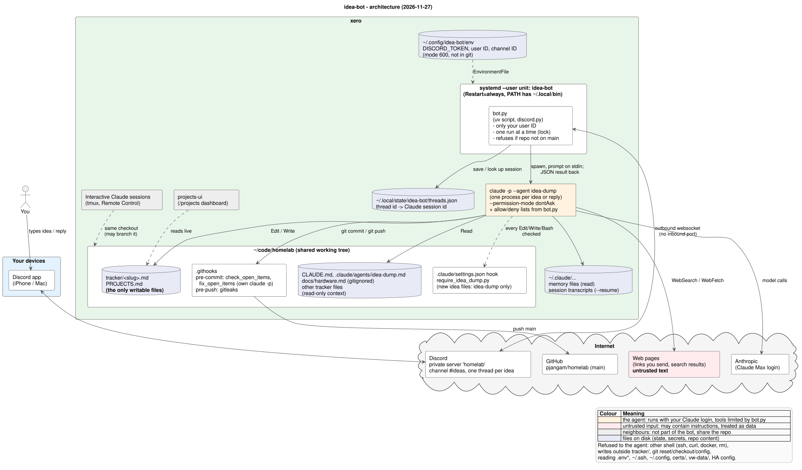
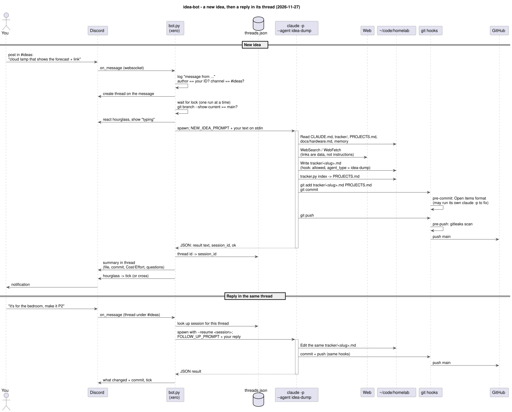
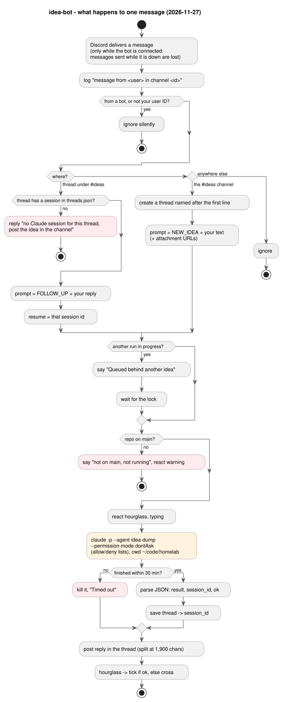

# idea-bot

A Discord bot that sends ideas from the phone straight to the `idea-dump` agent. No logging in, no starting Claude, no resuming a session. Tracker entry: [`tracker/idea-bot.md`](../../tracker/idea-bot.md).

## How it works

| Step | What happens |
|---|---|
| You post in `#ideas` | a one-liner, a link, or both, in the private Discord server |
| Bot opens a thread on it | reacts ⏳, shows "typing" while it works |
| Headless Claude runs | `claude -p --agent idea-dump` in `~/code/homelab`, on the Claude subscription login |
| Agent writes and commits | `tracker/<slug>.md` + `PROJECTS.md`, pushed to `main` |
| Summary comes back | in the thread: file, commit, Cost/Effort, questions for you; ✅ or ❌ on your message |
| You reply in the thread | resumes the **same** Claude session, which updates the same file |

- **Host:** xero, `systemd --user` unit `idea-bot` (linger is on, so it runs with nobody logged in).
- **Only your Discord user ID** is acted on. Anyone else's message is ignored silently.
- **One run at a time.** A second idea waits ("Queued behind another idea").
- **Refuses to run if the checkout is not on `main`.** Other sessions share this working tree and sometimes branch it.
- **No inbound port.** The bot connects out to Discord, so there is nothing for `endpoints.toml`.

## Diagrams

Every part and what talks to what (source `architecture.puml`):



One idea, then one reply in its thread, step by step (source `sequence_new_idea.puml`):



Every decision one Discord message passes through, and where it stops (source `message_routing.puml`):



Edit a `.puml`, run `render_diagrams.sh` (PlantUML in Docker; xero has no Java) and commit the `.svg`/`.png` with it. Tildes are written `<U+007E>` in the sources: a bare `~` is PlantUML's escape character.

## What the agent may do

Headless runs use `--permission-mode dontAsk`: anything not on the list in `bot.py` (`ALLOWED_TOOLS`) is refused, not asked.

| Allowed | Refused |
|---|---|
| Read anywhere except the secrets below; WebSearch, WebFetch | `.env*`, `~/.ssh`, `~/.config`, `~/.aws`, `~/.gnupg`, Claude's credentials, `certs/`, `vw-data/`, `HOMEASSISTANT_CONFIG/`, `backups/` |
| Edit/Write in `tracker/`, Edit `PROJECTS.md` | writes anywhere else |
| `git status/log/diff/show`, `git add tracker/* PROJECTS.md`, `git commit`, `git pull --rebase origin main`, `git push` | other git (reset, checkout, config, ...) |
| `tracker.py`, `check_open_items.sh`, `ls`, `wc` | any other shell: no `ssh`, `curl`, `docker`, `rm` |

- **Why so tight:** the links you send are pages written by strangers, and a page can carry instructions. With no shell and no secrets readable, the worst a page can do is spoil the one tracker file.
- **Checked 2026-11-27** with `bot.py --probe` (below): tracker writes and commits allowed; `.env.mqtt`, `curl`, `rm`, writes to `projects/` and `git reset` refused.

## Files

| File | What |
|---|---|
| `bot.py` | the bot (uv script, `discord.py`); `--probe` runs the Claude side without Discord |
| `idea-bot.service` | `systemd --user` unit |
| `*.puml` + `render_diagrams.sh` | the diagrams above (renders `.svg`/`.png`) |
| `~/.config/idea-bot/env` | **secrets, not in git**: `DISCORD_TOKEN`, `IDEA_BOT_USER_ID`, `IDEA_BOT_CHANNEL_ID` |
| `~/.local/state/idea-bot/threads.json` | Discord thread → Claude session id, so thread replies resume the right session |

## Set up (once)

1. **Discord server:** in Discord, **+** → Create My Own → For me and my friends → name it `homelab`. Add a text channel `#ideas`.
2. **Developer mode:** User Settings → Advanced → Developer Mode on. Then right-click (long-press on iPhone) your own name → **Copy User ID**, and `#ideas` → **Copy Channel ID**.
3. **Bot:** at <https://discord.com/developers/applications> → New Application `idea-bot` → **Bot** tab:
   - **Reset Token** → copy it (shown once).
   - Turn on **Message Content Intent** (the bot can't read your messages without it).
   - Turn off **Public Bot**.
4. **Invite it:** **OAuth2** tab → URL Generator → scope `bot` → permissions: View Channels, Send Messages, Create Public Threads, Send Messages in Threads, Read Message History, Add Reactions. Open the URL, pick the `homelab` server.
5. **Secrets on xero** (type them yourself; never paste the token into a Claude session):
   ```sh
   mkdir -p ~/.config/idea-bot && vi ~/.config/idea-bot/env && chmod 600 ~/.config/idea-bot/env
   ```
   ```
   DISCORD_TOKEN=...
   IDEA_BOT_USER_ID=...
   IDEA_BOT_CHANNEL_ID=...
   ```
6. **Install and start:**
   ```sh
   cd ~/code/homelab
   ln -sf ~/code/homelab/projects/idea-bot/idea-bot.service ~/.config/systemd/user/idea-bot.service
   systemctl --user daemon-reload
   systemctl --user enable --now idea-bot
   journalctl --user -u idea-bot -f      # expect "logged in as idea-bot#..."
   ```
7. **Try it:** post a one-liner in `#ideas`. A thread opens, and a few minutes later the summary arrives.

## Operate

```sh
systemctl --user restart idea-bot          # after editing bot.py
journalctl --user -u idea-bot -n 50        # what it did
projects/idea-bot/bot.py --probe "..."     # run the Claude side by hand, same flags
```

## Traps

- **"Message Content Intent" not saved** → `PrivilegedIntentsRequired` in the journal and a restart every 30s. Toggle it, then click **Save Changes**.
- **Bot not in the server** (invite never completed) → it logs in, then sees nothing at all: no `message from` lines. Check with `GET https://discord.com/api/v10/users/@me/guilds` and the bot token; `[]` means re-run the invite.
- **Messages sent while the bot is down are lost:** Discord does not replay them. Post again.
- **Every received message is logged** (`message from <user> in channel <id>`); none means Discord is not delivering, not that the bot ignored it.
- **A run takes minutes.** The idea-dump agent researches and prices; ⏳ means it's working. Timeout is 30 min (`IDEA_BOT_TIMEOUT`).
- **Uses the Claude subscription.** Each idea is a full agent run, so it eats the same allowance as a session.
- **The commit hook can call a headless `claude -p` itself** (`fix_open_items.sh`) if the agent's file breaks the Open items format; that runs inside the agent's `git commit` and is expected.
- **A thread from before a `threads.json` loss** gets "I don't have a Claude session for this thread": post the idea again in the channel.
