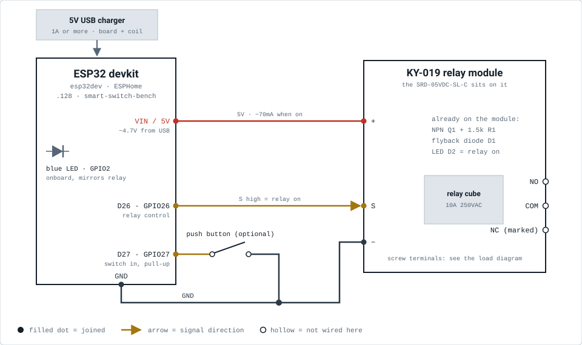
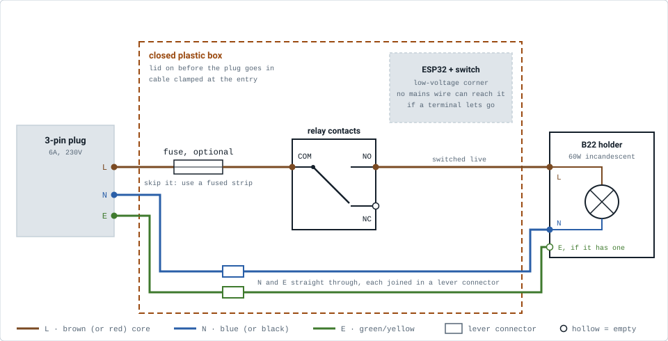

# Smart switch wiring: ESP32 + relay module for the akash kandil

One ESP32 devkit switching the stash relay module, which switches the akash kandil's
230V bulb on the Diwali timer. Two halves:

- **Low voltage:** USB, ESP32, switch, relay module. Safe to get wrong and try again.
- **Mains:** wired with the plug out, checked with a meter, and closed in a plastic box
  before it ever goes into a socket.

Firmware: `esphome/smart-switch-bench.yaml`. How to flash it: `README.md`.

## 1. ESP32 to the relay module

| From (ESP32) | To | Why it matters |
|---|---|---|
| `VIN` (`5V` on 38-pin boards) | module **+** | USB 5V through the board, ~4.7V. The coil needs ~70mA and closes at 3.75V or more. Never `3V3`. |
| `GPIO26` (`D26`) | module **S** | The relay command. High = relay on (`relay_inverted: "false"`). Not a strapping pin, so it can't stop the board booting. |
| `GND` | module **−** | One supply, one ground. Any GND pin on the board. |
| `GPIO27` (`D27`) | rocker switch, other side to `GND` | **Optional** manual on/off on the box, Tinxy-style: flip on = relay on, flip off = relay off; HA and the timer can change the relay in between. Works without WiFi. Low voltage only. Leave it out and HA + the timer still work. |
| onboard LED (`GPIO2`) | nothing to wire | The firmware mirrors the relay on it. |

The module is a KY-019 type: header **S + −**, an NPN transistor (Q1), a 1.5k base
resistor (R1, printed "152"), a flyback diode and an LED. No optocoupler. 3.3V on S
is plenty: about 1.7mA of base current for a ~70mA coil.

**Finding the pins:** on the ESP32, all four are on one header row. The print may say
`D26`, `IO26`, `G26` or just `26`, so read the labels rather than counting pins. The
module's header pins and the devkit's pins are both male, so use **female-female**
jumpers.

## 2. Mains side: the kandil bulb

The relay is a switch in the live wire. Wired to NO, a dead ESP32 means the bulb is
off, never stuck on.

| From | To | Why it matters |
|---|---|---|
| plug **L** | T2A fuse → relay **COM** (middle terminal) | Switch and fuse the live, never the neutral. Switching neutral turns the bulb off but leaves the holder at 230V. |
| relay **NO** (the end opposite the NC marking) | bulb holder L (centre contact) | Relay unpowered = bulb off. |
| plug **N** | bulb holder N | Straight through, joined in a lever connector in the box. Never through the relay. |
| plug **E** | holder earth screw, if any | A plastic B22 holder has none: end the earth core in its own lever connector. |
| relay **NC** (marked) | nothing | Leave it empty, screw done up. |

**Confirm the terminals before wiring**, multimeter on continuity, module unpowered:
middle to the NC end beeps, middle to the other end stays silent.

## 3. Safety

- **Plug out for every mains step.** Not just the socket switch off: out of the wall.
  The box lid goes on before the plug goes in.
- **Keep the two halves apart in the box.** ESP32, USB cable and switch in one corner;
  fuse, relay terminals and lever connectors in the other, a few cm apart. Cable-tie the
  mains cores so a loose one can't swing across. Clamp the mains cable where it enters
  the box, so a tug pulls on the box, not on the screw terminals.
- **Use a 3-pin plug.** A 2-pin plug fits either way round, so half the time the relay
  would switch neutral and leave the holder live while the bulb is "off".
- **The 40-60W bulb is the heat source, not the relay.** The kandil is jute and keeps
  its incandescent bulb on purpose (the clear filament throws the weave as shadows).
  The glass runs well over 100°C, on a timer, unattended. Hang the bulb in the middle
  of the lantern, clear of the jute on every side, with the top and bottom open so heat
  rises out. After the first hour, feel the jute nearest the bulb: warm is the limit,
  hot means more clearance (or the 40W instead of the 60W).
- **Lights only.** The module's tracks and screw terminals are the weak link, not the
  cube's 10A rating. Fine at 0.26A, not for a heater, geyser or iron.

## 4. Parts checklist

Prices are rough local-shop figures.

| Part | Have it? | If buying, ₹ |
|---|---|---|
| ESP32 devkit (esp32dev, WROOM-32) | yes, the spare | |
| SONGLE relay on the KY-019 module | yes | |
| 3 female-female jumper wires | likely | 40-60 |
| USB data cable + 5V charger, 1A or more | yes | |
| Small rocker or toggle switch, latching (optional; a jumper wire works for the bench) | maybe | 15-30 |
| Multimeter with continuity | yes | |
| 3-pin 6A plug | maybe | 40-80 |
| 0.75mm² flexible cable, 3-core, 2-3m | maybe | 25-40 / m |
| B22 pendant bulb holder | probably, with the kandil | 30-60 |
| Bulb: 40-60W incandescent, clear | yes | |
| Inline fuse holder (5x20mm) + T2A slow-blow fuse, and a spare | no | 30-60 + 5-10 |
| Plastic junction box with a screw lid | maybe | 60-150 |
| 2-3 lever connectors (WAGO 221 or similar) | maybe | 20-40 each |
| Cable gland or grommet + cable ties | maybe | 10-30 |
| Insulation tape, heat shrink | yes | |

## 5. Check in this order

Each step adds one thing, so a failure points at that thing. Steps 1-6 are low voltage.
Build the mains side only after step 6 passes.

1. **ESP32 on USB, nothing attached.** Flash it and add it to HA (`README.md`), then
   toggle `Relay` in HA. *Expected:* the blue onboard LED follows. If not, the problem is
   firmware or HA, not wiring: read `./esphome.sh logs`.
2. **Optional: add the rocker** (or a jumper wire) between `GPIO27` and `GND`.
   *Expected:* flip on = blue LED on, flip off = LED off, and HA's `Switch position`
   follows. Then with the rocker on, turn `Relay` off in HA: it stays off until the
   rocker is flipped off and on again. Nothing = wrong pin. Never jumper a GPIO to `VIN`.
3. **Unplug USB, wire the module** (S, +, −), plug back in. *Expected:* no click at boot,
   one click per toggle in HA, and the module's LED follows. On when HA says off = the
   wrong `relay_inverted` setting.
4. **Meter on COM-NO while toggling.** *Expected:* beeps when on, silent when off. The
   reverse = you are on COM-NC.
5. **Without the network** (only if you fitted the rocker): unplug the router (or block
   the board's WiFi) and flip it. *Expected:* the relay still follows.
6. **Power loss:** pull USB with the relay on, plug back in. *Expected:* it comes back on.
7. **Plug out of the wall:** build the mains side, then meter it from the plug's pins
   with the bulb fitted and the ESP32 on USB. L to N, relay off: open. Relay on: ~60-90Ω
   for a 60W bulb (cold filament). E to L and E to N: open. 0Ω when on = a short at the
   holder, don't plug in. Reads through when off = the bulb is on NC.
8. **Lid on, then plug in.** Toggle from HA and from the switch: the bulb follows. Let it
   run an hour inside the kandil and feel the jute before trusting it to the timer.

## The numbers

- **Coil:** ~70Ω, 67-71mA at the 4.7-5V the `VIN` pin gives; closes at 3.75V or more.
- **USB budget:** ESP32 ~250mA peak on WiFi + 70mA coil ≈ 320mA. Any 1A charger.
- **Bulb:** 60W / 230V = 0.26A steady; ~2.6A for a few milliseconds when the cold
  filament switches on. Fine for 10A contacts. A T2A slow-blow fuse rides through that
  and still blows on a short; a 1A fast fuse can blow on the switch-on surge alone.
