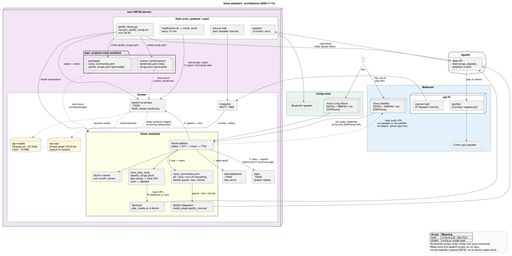
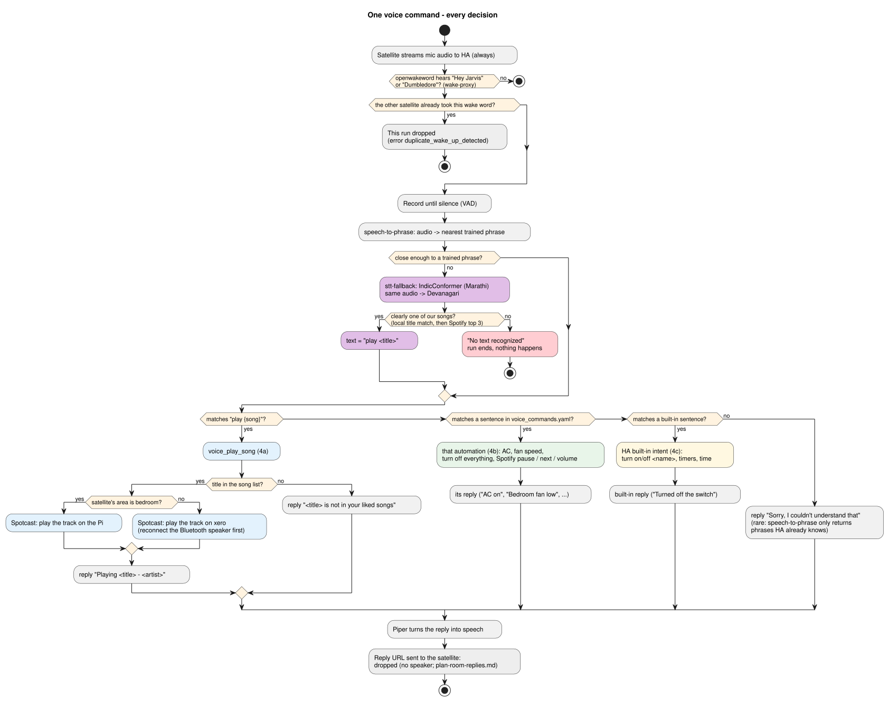
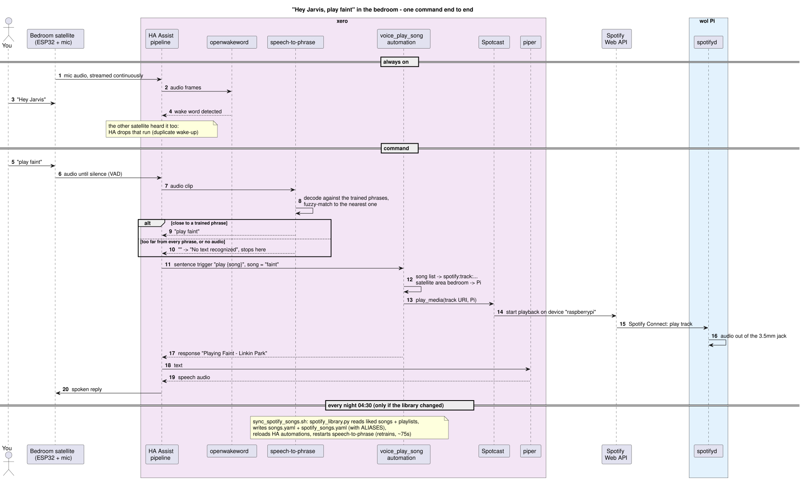

# Voice assistant (HA Assist, local)

Voice control for lights, white noise, fans and the AC through Home
Assistant's built-in **Assist**. Fully local, not "smart": speech is matched
against a fixed set of commands for the entities exposed to Assist.

HA here is a plain Docker container, not HA OS, so voice add-ons cannot be
installed. That is very likely why an earlier attempt at a voice plugin never
worked. Each voice piece runs as its own container in `docker-compose.yml`,
connected to HA through the Wyoming integration.

## Architecture

Every part and what talks to what (source `architecture.puml`):



Every decision one command passes through - which of the three handlers (4a/4b/4c above) runs, and where a command can end early (source `intent_routing.puml`):



One "Hey Jarvis, play faint" in the bedroom, step by step (source `sequence_play_song.puml`):



Edit the `.puml`, then run `render_architecture.sh` (PlantUML in Docker) and commit the `.svg`/`.png` with it.

## Pieces

| Piece | Where |
|---|---|
| Speech-to-text | `stt-fallback` container on `127.0.0.1:10300` (what HA's `stt.speech_to_phrase` points at) -> `speech-to-phrase` container (`127.0.0.1:10301` for direct tests). Legacy v1.4 (Kaldi) image: the newer Speech-to-Phrase ships only as an HA OS app. Why this one: "Choosing the speech-to-text" below; the proxy: "Marathi fallback" below. |
| Command matching | HA's own conversation agent (`prefer_local_intents` on), plus `packages/voice_commands.yaml` for what its built-in sentences do not cover |
| Text-to-speech | `piper` container, `127.0.0.1:10200`, voice `en_US-lessac-medium`. **Required, not optional** - see Gotchas. |
| Spoken replies | No speaker on the satellites: replies play on the room's own speaker (Pi jack / xero Bluetooth) through the `voice-reply` bridge, and music is paused at the wake word and resumed after - "Spoken replies and play button" below |
| Pipeline | The preferred "Home Assistant" Assist pipeline: `stt.speech_to_phrase` + `tts.piper` |
| Mic | Two ESP32 + INMP441 satellites on ESPHome (Voice Satellite in the bedroom, Voice Living Room), streaming audio to HA all the time; wake words **"Hey Jarvis" and "Dumbledore"** (both live since 2026-11-16, see "Two wake words") in the `openwakeword` container on xero, reached through `wake-proxy` (the boards are original ESP32s, no on-device wake word: see "Why the wake word runs on xero"). Also the HA phone app's Assist button. Wiring: `wiring.html` |

## Choosing the speech-to-text

**Speech-to-Phrase** has been in use since 2026-10-05 and was confirmed for songs on 2026-11-04. Whisper was benchmarked but never deployed. Constraints:
- **Free:** no paid or cloud speech-to-text (user, 2026-11-04).
- **Hardware:** xero's N5105 CPU, no GPU.
- **Speed:** a reply within about a second.

Timing per request on xero, using clean Google TTS clips of 1.4-2.8s. Real satellite audio does worse. Scripts: `bench_whisper.sh`, `bench_moonshine.sh`.

| Engine | Time per request | English song titles | Marathi ("aggobai dhaggobai") | Verdict |
|---|---|---|---|---|
| **Speech-to-Phrase** (Kaldi, closed vocabulary) | **~0.5s** | 15/16 random titles from the library | only through hand-made aliases ("ago by dhago by"), borderline with real voice | **in use**: fast, and it never invents a command |
| Whisper `tiny.en` | ~1.5s | wrong ("papercut" -> "people good") | garbled | too inaccurate |
| Whisper `base.en` | ~3s | mostly right ("papercut" -> "people gut") | garbled | slow, and still misses some |
| Whisper `small.en` / `distil-small.en` | 10-15s / ~9.5s | all right | garbled | far too slow |
| Moonshine `tiny` / `base` | 0.2-0.4s / 0.5-0.9s | like Whisper base | garbled | fast, but not accurate enough on its own |
| IndicConformer Marathi (AI4Bharat, int8 ONNX) | p50 0.7s, p95 1.4s | not meant for English (non-songs come out as nothing) | **28/30 right, 0 wrong** (Marathi and English TTS voices) | **fallback** for Marathi titles, live since 2026-11-15 (below) |

Why Speech-to-Phrase:
- **Speed:** it is the only accurate option fast enough on the N5105.
- **No made-up commands:** it can only return a phrase it was trained on (or nothing), so noise never becomes a wrong command. The cost is that it can't hear anything it wasn't trained on: every song title must be in the trained list, and Marathi needs aliases.
- **The English model fails on Marathi pronunciation.** Speech-to-Phrase uses Rhasspy's English Kaldi model (2021). Google's Marathi voice failed on every clip; real voice sits in between.

## Two wake words (`wake-proxy`, since 2026-11-16)

Either "Hey Jarvis" or "Dumbledore" wakes both satellites. No flashing: the boards only stream audio; wake words are detected on xero.

| Piece | What |
|---|---|
| `wake-proxy` container, `127.0.0.1:10400` (what HA's openWakeWord integration points at) | `wake_proxy.py`: HA asks for one wake word (the pipeline's `hey_jarvis`); the proxy adds `EXTRA_WAKE_WORDS` (`dumbledore`) to the request and reports a Dumbledore detection back as `hey_jarvis`, which HA would otherwise drop ("Expected wake word ... skipping") |
| `openwakeword` container, `127.0.0.1:10401` | the detector; an extra word must be in its `--preload-model` list |
| Logs | `docker logs wake-proxy`: one line per detection with the word really heard - use it to count false wakes per word |
| Test | `wyoming_wake.py 127.0.0.1:10400 hey_jarvis clip.wav` (through the proxy) or `:10401` (direct) |

- **Tested 2026-11-16 with TTS clips:** "hey jarvis" detected; "dumbledore" detected for 2 of 6 synthetic voices (Google en-GB, Piper), none for the others - real voice is the test. "turn on the fan" not detected. Both satellites reconnected through the proxy; openwakeword CPU unchanged (~39% of one core), proxy ~6%.
- **Add or drop a word:** `EXTRA_WAKE_WORDS` in `docker-compose.yml` (and `--preload-model`), `docker compose up -d wake-proxy`.
- **Rollback:** point openwakeword back at `127.0.0.1:10400:10400` and remove `wake-proxy`.
- More wake words = more false wakes (each adds its own).

### Why the wake word runs on xero (checked 2026-11-19)

- **openWakeWord cannot run on an ESP32** - it is a Python/ONNX model. The on-device engine is **microWakeWord**, a different project.
- **microWakeWord needs an ESP32-S3 with PSRAM.** Both satellites are original ESP32s, which ESPHome does not support for it.
- **What on-device would gain:** the board streams audio only after the wake word (less WiFi traffic, less load on xero). It would not help the bedroom white-noise problem: the hiss masks the voice at the mic either way.
- **What it would cost:** two ESP32-S3 boards, re-wiring the mics, a reflash, and "Dumbledore" (only the wake-proxy offers it; microWakeWord ships okay nabu, hey jarvis, alexa).
- **Decision:** stay on xero; revisit only if the boards are replaced for another reason.

## Marathi fallback (`stt-fallback`, since 2026-11-15)

A Wyoming proxy (`stt_fallback.py`) in front of Speech-to-Phrase. Built 2026-11-15 after Marathi titles kept coming back "No text recognized".

| Step | What happens |
|---|---|
| 1 | HA sends the audio to `127.0.0.1:10300`, the proxy, as it did to Speech-to-Phrase before - HA's config did not change |
| 2 | The proxy passes it to `speech-to-phrase:10300` and returns its answer unchanged |
| 3 | **Only if that answer is empty:** the same audio goes through IndicConformer (Marathi, ~1s), which writes Devanagari |
| 4 | `devanagari_match.py`: to rough Latin -> fuzzy match against our song titles (needs a clear winner), else Spotify search top 3 if the track is in our library |
| 5 | A song -> the transcript becomes `play <spoken title>` and the usual "play {song}" automation plays it. No song -> stays empty, as before |

- **Logs:** `docker logs stt-fallback` - one line per fallback: what it heard in Devanagari, the song or "nothing", the time.
- **Cost:** only failed commands get slower (~1s). Working commands pass through untouched.
- **Fails safe:** model not loaded, an error, Spotify down -> the empty answer goes through as before. If the container itself is down, voice is down: `docker compose up -d stt-fallback`, or point HA at 10301.
- **Image:** `indicconformer` is local (Immich's ML image + onnx-asr), built by `build_indicconformer_image.sh`; watchtower skips it. Model in the `indicconformer-cache` volume (downloaded on first start).
- **Song list:** re-read whenever the nightly sync rewrites `packages/spotify_songs.yaml`; no restart needed. Code is bind-mounted: `docker restart stt-fallback` after editing it.
- **Fallback, not parallel** (measured 2026-11-15, `bench_stt_parallel.sh`): starting IndicConformer alongside Speech-to-Phrase on every request saves ~0.6-0.9s on a Marathi miss, but slows **every** English command by ~0.4-0.6s (2 threads) or up to ~1.2s (all 4 cores) on xero's CPU. English commands are far more common, so it stays a fallback. `PARALLEL=1` / `IC_THREADS=2` in the container's environment switch it on if that changes.
- **Test without HA:** `wyoming_transcribe.py 127.0.0.1:10300 clip.wav` (proxy) vs `127.0.0.1:10301` (Speech-to-Phrase alone).

## Spoken replies and play button (since 2026-11-18)

The satellites have no speaker, so HA's spoken reply goes to the speaker already in each room. Plan, decisions and reviews: `plan-room-replies.md`.

| Piece | Where |
|---|---|
| Reply bridge | `voice_reply_mqtt.py` as `voice-reply.service` + an always-running VLC `voice-reply-vlc.service` (systemd --user) on the **Pi** (bedroom, jack) and **xero** (living room, Bluetooth). Install / update: `install_voice_reply.sh pi` / `xero` (run on xero) |
| HA | `packages/voice_replies.yaml` (helpers, `voice_reply`, `voice_resume`, `voice_start_music`, wake-word pause, event handlers, safety net), `packages/night_quiet.yaml` (night window, shared), `packages/play_button.yaml` |
| Firmware | `esphome/voice-satellite-common.yaml`: events `esphome.voice_reply {url}`, `voice_tone {gap_ms}`, `voice_end`; play button GPIO23 -> `esphome.play_button` |
| Gate | `input_boolean.voice_replies_enabled` ("Voice replies" tile, Bedroom view). **On since 2026-11-18**, when both boards were flashed with the events. Off -> the wake word pauses nothing and no reply plays; resume and the safety net keep running |
| Presets | Reply volume tiles: bedroom 93, bedroom at night (22:00-07:00) by ear, living room 35. The Pi's `%` is linear in dB: 40 there is ~-60 dB, inaudible |
| Health | `binary_sensor.bedroom_voice_replies` / `living_room_voice_replies` (online while VLC answers); `healthcheck.sh` alerts after 15 min off |

How a command goes:
1. Wake word -> this room's music pauses (`voice_paused_<room>`).
2. HA runs the command; the board fires `voice_reply` with Piper's URL; the bridge sets the preset, plays it, restores the volume, answers `done`.
3. `voice_resume` restarts the music (it waits while a reply plays or a new command is under way).

Rules:
- **Bedroom:** no replies while white noise is on (also "play X" is refused then); at night no tone and the night preset.
- **No reply when music starts** ("play X", "next song", "resume the music" that worked): the music is the answer. A failure says "Couldn't ...".
- **Failure tone** (spoke, nothing recognised): only if the speech lasted `voice_tone_min_s`-`voice_tone_max_s` (2-12s); tune on those sliders, no reflash.
- **Bluetooth not connected** (living room): the reply is dropped, nothing waits.
- **"Done" instead of HA's chime** (since 2026-11-18): when every device a command touched is in the satellite's room, HA sends its acknowledge chime instead of the answer (hard-coded in `assist_pipeline`, no setting). The bridge spots the chime by its hash and plays `done.mp3` ("Done.", Piper lessac) instead. An HA update that changes `acknowledge.mp3` brings the chime back: add its hash to `ACK_SHA256`.
- **Short replies clipped to a blip** (living room, fixed 2026-11-18): the Bluetooth speaker drops the start of a sound after a quiet spell. On xero the bridge plays `~/.local/state/voice-reply/lead-in.wav` (0.8s of faint noise) before every reply and tone; xero's WirePlumber also never suspends the output (`projects/spotifyd/install_wireplumber_bt.sh`).
- **Play button:** plays the house playlist from its first track in that board's room, every press; 3s per press. Same script as the "Play Bedroom Track" / "Play playlist" tiles.

Test without a satellite (the commands really run):
- `docker exec mosquitto mosquitto_pub -u ... -t voice_reply/xero/play -m '{"id":"t","sound":"tone","volume":35}'`
- `say.py living_room "next song"` (HA_TOKEN from `.env.healthcheck`)
- fire `esphome.play_button` with a board's `device_id` from Developer Tools.

Logs: `journalctl --user -u voice-reply` (xero); `ssh pramod@192.168.1.124 'journalctl _SYSTEMD_USER_UNIT=voice-reply.service'` (Pi).

## Commands

Built in (HA + Speech-to-Phrase): `turn on/off <name>` for any exposed light,
switch, fan or media player; `activate <scene> scene`; `run <script> script`;
timers; `what time is it`.

Added in `packages/voice_commands.yaml` (sentence-trigger automations):
- `turn on/off the AC`, `set the AC to 24 [degrees]`, `AC 24 degrees` (16-30)
- `[set the] [bedroom] fan [to] high|fast|medium|low|slow` (bare "fan" = bedroom)
- `hall fan fast`, `living room fan low`, ...

### Spotify (added 2026-11-04)

Commands to try on either satellite:
- "Play \<song title\>", "play \<title\> by \<artist\>" or "play the song \<title\>": works for any of your liked songs and the playlists in `PLAYLISTS` (546 songs on 2026-11-07) and plays that exact track - on the Pi's speaker when the bedroom satellite heard it, on xero's otherwise (`SPEAKERS` in `spotify_library.py`). It never searches Spotify, so it can't pick the wrong song.
  - **xero's speaker is Bluetooth (2026-11-14):** before playing there, the automation asks xero over MQTT (`bt_speaker_xero/connect`) to reconnect the speaker and waits up to 25s for the answer; ~5s when it was disconnected. See `projects/spotifyd/README.md`.
- "Pause the music" or "stop the music"; "resume the music". **Room guard (2026-11-18):** said on a satellite, these and next/previous/volume act only on the music in that room, else "The music is in the bedroom". Only multi-word forms - bare "pause"/"next" wait for a day of debug recordings; Spotify is meant to be hidden from HA's built-ins (open item).
- "Next song" or "skip this song"; "previous song" (the first time restarts the song, which is Spotify's normal behaviour, so say it twice to go back a song).
- "Music volume up/down", "turn the music up/down", "set the music volume to 40".

Notes:
- Titles are as spoken: suffixes like "- Remastered 2011" and "(feat. X)" are
  dropped. The list is synced nightly from the liked songs and `PLAYLISTS`
  (see the files below), so it grows as songs are liked or added.
- **Misheard titles:** the recogniser always returns the closest phrase in its
  list, so a short title can come out as another ("in the end" was heard as
  "billie jean", 2026-11-07). Saying "\<title\> by \<artist\>" gives it more to
  go on. For Marathi titles the bare title works better.
- **A title that never matches:** look up the pronunciation Speech-to-Phrase
  guessed: `docker exec speech-to-phrase grep -i '^<word>' /train/en_US-rhasspy/missing_words_dictionary.txt`.
  It reads the spelling as English ("aggobai" -> AG-uh-bye), so add an `ALIASES`
  entry spelled with English words that sound right ("ago bye the go bye").
- **Marathi-voice test:** `TTS_LANG=mr projects/voice-assistant/test_stt.sh "प्ले ..."`.
  It fails even for titles that work by voice, so treat it as a worst case.
- **Add a playlist:** put its id (from the share link, after `/playlist/`) in
  `PLAYLISTS` in `spotify_library.py`, then run `sync_spotify_songs.sh`.
- Marathi/Hindi titles in Latin script are recognised when Speech-to-Phrase
  guesses their pronunciation well enough, and fail otherwise (user's call).
  A title that matters and fails gets an entry in `ALIASES` in
  `spotify_library.py`.

Names and aliases come from `setup_assist.py`: bedroom light / tube light,
bedroom bulb, balcony light, bedroom fan, hall light, shelf light, hall fan,
white noise, AC.

## Files

- `voice_reply_mqtt.py`, `voice-reply.service`, `voice-reply-vlc.service`, `install_voice_reply.sh` - the spoken-reply bridge on the Pi and xero (above).
- `say.py` - run sentences through HA as a satellite (they really run).
- `setup_assist.py` - idempotent: which entities are exposed (and the stale
  Tinxy duplicates that are not), aliases, device areas, the Wyoming entry and
  the pipeline's STT. Edit the lists at its top, re-run, then restart
  `speech-to-phrase`.
- `packages/` - bind-mounted to `/config/packages`; loaded by
  `homeassistant: packages: !include_dir_named packages` in the gitignored
  `HOMEASSISTANT_CONFIG/configuration.yaml` (added 2026-10-05). Reload with
  `automation.reload` after editing.
- `custom_sentences/en/` - lists for `{wildcards}` in the sentence triggers
  (Speech-to-Phrase cannot hear a wildcard without one).
- `spotify_library.py` - writes the two gitignored generated files behind
  "play <song>": `custom_sentences/en/songs.yaml` (the list Speech-to-Phrase
  trains on) and `packages/spotify_songs.yaml` (the HA automation, title ->
  track URI). Reads the token HA's Spotify integration keeps in
  `.storage/core.config_entries`, read-only; it never refreshes it.
- `sync_spotify_songs.sh` - timer `job-spotify-songs-sync`, daily 04:30: runs the above and, only if the
  list changed, reloads automations and restarts speech-to-phrase (~30s of
  training for ~500 titles, when the satellites hear nothing). Log
  `spotify-songs.log`. Run by hand after liking a song you want now.
- `bench_whisper.sh`, `bench_moonshine.sh` - timing of free-form STT on xero
  for a future "play anything" (results: "Choosing the speech-to-text" above).
- `spotify_devanagari_search.py` - does Spotify search find our Marathi songs
  from Devanagari titles (read-only; 2026-11-15: 21/27).
- `stt_fallback.py` - the `stt-fallback` Wyoming proxy ("Marathi fallback" above).
- `devanagari_match.py` - Devanagari transcript -> one of our songs, or nothing.
- `Dockerfile.indicconformer` + `build_indicconformer_image.sh` - the local
  `indicconformer` image (stt-fallback and the bench).
- `bench_indicconformer.sh` - IndicConformer timing and matches on TTS clips
  (results: "Choosing the speech-to-text" above).
- `wyoming_transcribe.py` - send a WAV straight to a Wyoming STT port.
- `bench_stt_parallel.sh` - fallback vs parallel timing of the proxy (test copy on :10302).
- `architecture.puml`, `intent_routing.puml`, `sequence_play_song.puml` + `render_architecture.sh` - the diagrams above (renders `.svg`/`.png`)
- `ha_ws.py` - tiny HA websocket client used by the above.
- `test_pipeline_ws.py file.wav [end_stage]` - runs the pipeline over the
  websocket exactly as the phone app does for voice (binary audio frames).
  `end_stage tts` reproduces the app's request.
- `watch_assist.sh` - live view of voice runs stage by stage, HA log and
  speech-to-phrase log, for "the client does nothing" debugging.
- `esphome/` - the ESP32 satellites: `voice-satellite-common.yaml` (shared), one small file per board - `voice-satellite.yaml` (first board, .125, HA area Bedroom) and `voice-living-room.yaml` (.126, waiting on a second INMP441) - `build_on_mac.sh [living]`, `esphome.sh`
  (ESPHome in docker: `compile`, `run --device /dev/ttyUSB0`, later OTA to
  192.168.1.125), and the gitignored `secrets.yaml` (Wi-Fi, API key, OTA
  password). **Prefer xero over the Mac for a first build (2026-10-24):** `build_on_mac.sh`
  could not fetch ESPHome's ESP-IDF tarball - GitHub release assets came down at
  7-9 KB/s, so the download timed out. **This comes and goes:** the same
  TCP-and-TLS-fine-but-no-data symptom hit PyPI and `deb.debian.org` from xero
  and the Pi on 2026-10-22 and cleared within the hour (`PROJECTS.md`, LAN
  gateway Log). So the Mac path may work again; test it with a quick
  `curl -r 0-2000000 -w '%{speed_download}'` against the tarball URL before
  committing to it. Compile on xero
  instead, where ESP-IDF 5.5.5 is already cached in the `esphome-build` volume:
  `CONFIG=voice-living-room.yaml esphome.sh compile`, then either flash there
  (`esphome.sh flash-bin`) or pull `firmware.factory.bin` out of the volume
  (`docker run --rm -v esphome-build:/v alpine cat /v/build/<name>/build/firmware.factory.bin`)
  and write it from the Mac with `esptool --port /dev/cu.usbserial-0001 --baud 460800 write-flash 0x0 <bin>`.
  An already-flashed board takes an **OTA** instead, which needs none of this.
  If the Mac venv ever has to be rebuilt, pin `cbor2==5.7.1`: cbor2 6.x ships
  macOS wheels for arm64 only and this MacBook is Intel. `check_usb_serial.sh`
  diagnoses a board that does not appear on USB (two of three cables were
  charge-only on 2026-10-24).
  **The old caveat, still true:** the RAM is replaced and cleared
  (2026-10-09), but a full-core build still runs xero in the 90s°C on its
  pegboard until "xero cooling" in PROJECTS.md is done. Build on the Mac instead: `esphome/build_on_mac.sh` from a
  clone (venv, no Docker) flashes over USB on the Mac, OTA, or copies the
  `.bin` to xero for `esphome.sh flash-bin`.
- `wakewords/` - custom openWakeWord models, mounted into the `openwakeword`
  container (`127.0.0.1:10401` direct, `10400` through `wake-proxy`; preloads `hey_jarvis`, the wake word since 2026-10-08, `okay_nabu` before).
  `andromeda.tflite` and `dumbledore.tflite` (from the community collection,
  https://github.com/fwartner/home-assistant-wakewords-collection, 2026-10-11)
  are preloaded too; **dumbledore is live** next to hey_jarvis since 2026-11-16
  (see "Two wake words"). The pipeline's `WAKE_WORD_ID` in `setup_assist.py`
  stays `hey_jarvis`; add `--debug` to openwakeword to see detections.
- `wake_proxy.py` - the `wake-proxy` container: several wake words live at once.
- `wyoming_wake.py` - streams a WAV to a Wyoming wake-word server, prints what it detects.
- `check_stt.sh` + `stt_probe.wav` - sends a saved "turn off the AC" clip
  (Piper's voice) through speech-to-text. Run every 15 min by
  `projects/healthcheck/healthcheck.sh`, which restarts speech-to-phrase
  when it fails (it trains on HA's custom sentences only at start, and can
  start before HA has loaded them after a boot), pushes a low-priority ntfy,
  and raises a problem only if the restart did not help. Restarts are logged
  in `~/.cache/healthcheck/stt-restarts.log`.
- `test_stt.sh` - synthesises phrases with HA's Google TTS and posts them to
  the STT API; transcription check only, executes nothing.
- `watch_satellite_power.sh [minutes] [ip] [entity]` - after changing a
  satellite's power supply, prints each change in its HA state and API port
  (default: living room, 15 min). **Give each satellite its own single-port
  charger:** on 2026-11-07 a spare port on a multi-port GaN charger, shared
  with a Mac sitting at 99%, kept knocking the living room board off HA.
  To read a board's serial log from xero (no pyserial on the host):
  `docker run --rm --device /dev/ttyUSB0 -v $PWD/tools/esp32-tools:/t:ro --entrypoint python3 ghcr.io/esphome/esphome:stable /t/read-esp32-serial.py --no-reset`.

```sh
set -a; . ./.env.healthcheck; set +a      # HA_TOKEN for the scripts
projects/voice-assistant/setup_assist.py
docker restart speech-to-phrase          # retrain on new names/sentences
projects/voice-assistant/test_stt.sh "turn on white noise"
```

The container's own HA token is `HA_TOKEN_SPEECH_TO_PHRASE` in `.env`
(long-lived token "speech-to-phrase" in HA's profile page).

## Claude pipeline and the "Ask home" Shortcut (car)

Hands-free questions while driving, home or general: "Hey Siri, ask home".
Separate from everything above: the phone's Siri does the speech-to-text and
speaks the reply, so Speech-to-Phrase and Piper are not involved, and the
preferred "Home Assistant" pipeline and the satellites are unchanged.

- **Agent:** HA's Anthropic integration ("Claude"), model `claude-haiku-5-5`
  (fastest), web search on, replies capped short, instructions written for
  being heard in a car. It sees only the entities exposed to Assist.
- **Pipeline "Claude":** that agent with "prefer handling commands locally"
  on, so "turn off the hall fan" is still handled by HA itself (instant, free)
  and only the rest goes to Claude (paid per use on the API key).
- **Shortcut "Ask home"** on the iPhone: Dictate Text -> Home Assistant
  "Assist" action (pipeline "Claude", text = Dictated Text) -> Speak Text.

Set up, from the repo root (asks for the API key the first time; HA keeps it):

```sh
set -a; . ./.env.healthcheck; set +a
projects/voice-assistant/setup_claude_pipeline.py
```

Re-run it after changing the prompt or model at the top of the script
(`CLAUDE_MODEL=claude-sonnet-5-5 ...` to try a bigger model). It ends by
asking one home and one general question and printing Claude's answers.

Building the Shortcut (Shortcuts app on the iPhone, new Shortcut):
1. Add **Dictate Text** (Stop Listening: After Pause).
2. Add the Home Assistant app's **Assist** action; pick the server, set the
   pipeline to **Claude**, and the text to *Dictated Text*.
3. Add **Speak Text** with the Assist action's result.
4. Name it **Ask home**. Test on the phone ("Hey Siri, ask home"), then in
   the car through CarPlay.

If the Assist action has no pipeline choice: replace step 2 with **Get
Contents of URL**, POST `https://<HA tailnet URL>/api/conversation/process`,
header `Authorization: Bearer <long-lived token "car-shortcut">`, JSON body
`text` = Dictated Text, `agent_id` = the agent entity the script printed;
then **Get Dictionary Value** `response.speech.plain.speech` into Speak Text.
That skips prefer-local, so Claude handles home commands too (slower, works).

## Gotchas

- **The phone app's voice mode needs a TTS engine on the pipeline.** It always
  asks for `end_stage: tts`; without TTS, HA rejects the run with
  `validation-error: the pipeline does not support text-to-speech` before any
  audio is sent. The app shows nothing at all, typing still works, and the
  pipeline debug view lists the run with **zero events**. Cost an evening on
  2026-10-05 before `test_pipeline_ws.py ... tts` reproduced it.
- **Speech-to-Phrase spells initialisms out:** "AC" is transcribed "A C", and
  HA's matcher then knows no device called "A C". The sentence triggers list
  `(AC|A C|air conditioner)` for that reason. Do the same for any new
  initialism in a sentence trigger.
- **Retraining is only on start.** A newly exposed entity, a new alias or a new
  sentence trigger cannot be recognised until `docker restart speech-to-phrase`.
- **HA's alias list holds a `None`** as the slot for the entity's own name; keep
  it when editing aliases through the websocket API.
- Speech-to-Phrase only ever returns a sentence from its grammar, so a mumble
  can come back as the *nearest* command rather than nothing. Watch for false
  activations once a mic is always listening.
